<div align="center">



# Enfocate

**Estudia mejor, no más horas.**

Cuatro técnicas de estudio con respaldo científico en una sola app gratuita — sin cuentas, sin instalaciones.

[](https://react.dev)
[](https://www.typescriptlang.org)
[](https://vite.dev)
[](https://tailwindcss.com)

[Español](#-español) · [English](#-english)

</div>

---

## 🇪🇸 Español

### ¿Qué es Enfocate?

Enfocate es una aplicación web que reúne los métodos de estudio más eficaces en un solo lugar. Todo corre en tu navegador: **gratis, sin registro y respetando tu privacidad** — tus notas y sesiones nunca salen de tu dispositivo.

### Técnicas incluidas

| Técnica | Qué resuelve | Cómo lo hace |
|---|---|---|
| ⏱️ **Pomodoro** | Concentración | Bloques de 25 min con descansos automáticos (cortos de 5 min y largo de 15 min cada 4 ciclos) |
| 🎥 **Feynman** | Comprensión | Grábate explicando el tema con tu cámara; donde te trabas, hay que repasar |
| 📝 **Cornell** | Organización | Sistema de apuntes universitario con exportación a PDF |
| 🧠 **Mapas mentales** | Retención visual | 12 plantillas editables listas para personalizar en Canva |

### Características

- 🌗 **Modo día/noche** con cielo animado y estrellas fugaces, persistente entre visitas
- 🌍 **Bilingüe ES/EN** con detección y persistencia de preferencia
- 🔔 Timbre de aviso al terminar cada bloque (Web Audio API)
- 📊 Contador de sesiones completadas por día
- 🎧 Playlists curadas para concentrarte
- 📖 Guías paso a paso con capturas reales de la app
- ♿ Accesibilidad: foco visible, `prefers-reduced-motion`, etiquetas ARIA
- 📱 Diseño responsive mobile-first

### Stack técnico

React 19 · TypeScript · Vite 6 · Tailwind CSS 4 · React Router 7 · react-to-print · react-icons

Arquitectura destacada:

- **Context API** para tema e idioma globales con persistencia (`localStorage`)
- **i18n propio sin dependencias**: diccionarios tipados — cambiar una cadena en español marca error de compilación si falta su traducción
- **Datos centralizados**: registro único de técnicas consumido por navbar, landing, modales y guías

### Estructura del proyecto

```
src/
├── components/        # UI reutilizable (navbar, footer, modales, carrusel…)
│   └── home/          # Secciones de la landing
├── context/           # AppContext: tema + idioma persistentes
├── data/              # Registro de técnicas e imágenes de guías
├── i18n/              # Diccionarios tipados es/en
├── pages/             # Una página por ruta
├── styles/            # Fondos animados (cielo día / noche estrellada)
└── css/               # Design tokens Tailwind v4 (@theme)
```

### Puesta en marcha

```bash
git clone https://github.com/tu-usuario/enfocate.git
cd enfocate
npm install
npm run dev       # desarrollo → http://localhost:5173
npm run build     # producción → dist/
npm run preview   # servir el build localmente
```

---

## 🇬🇧 English

### What is Focus?

Focus is a web app that brings the most effective study methods together in one place. Everything runs in your browser: **free, no sign-up and privacy-friendly** — your notes and sessions never leave your device.

### Included techniques

| Technique | Problem it solves | How it works |
|---|---|---|
| ⏱️ **Pomodoro** | Focus | 25-min work blocks with automatic breaks (5-min short, 15-min long every 4 cycles) |
| 🎥 **Feynman** | Understanding | Record yourself explaining the topic with your camera; where you stumble, review |
| 📝 **Cornell** | Organization | University note-taking system with PDF export |
| 🧠 **Mind maps** | Visual recall | 12 editable templates ready to customize in Canva |

### Features

- 🌗 **Day/night mode** with animated sky and shooting stars, persisted across visits
- 🌍 **Bilingual EN/ES** with preference detection and persistence
- 🔔 Chime when each block ends (Web Audio API)
- 📊 Daily completed-sessions counter
- 🎧 Curated focus playlists
- 📖 Step-by-step guides with real app screenshots
- ♿ Accessibility: visible focus, `prefers-reduced-motion`, ARIA labels
- 📱 Mobile-first responsive design

### Tech stack

React 19 · TypeScript · Vite 6 · Tailwind CSS 4 · React Router 7 · react-to-print · react-icons

Architecture highlights:

- **Context API** for global theme & language with persistence (`localStorage`)
- **Dependency-free typed i18n**: adding a Spanish string without its English translation is a compile error
- **Centralized data**: single technique registry consumed by navbar, landing, modals and guides

### Getting started

```bash
git clone https://github.com/tu-usuario/enfocate.git
cd enfocate
npm install
npm run dev       # develop → http://localhost:5173
npm run build     # production → dist/
npm run preview   # serve the build locally
```

---

## 👥 Créditos / Credits

Enfocate empezó como proyecto universitario y sigue creciendo como proyecto abierto mantenido por los contribuidores.

| Persona | Rol |
|---|---|
| Alex Carrion | Líder del proyecto · Desarrollo |
| Alisson Guapulema | Desarrollo · QA |
| Andres Falcon | Desarrollo |
| Cristopher Chasiloa | Desarrollo |
| Jean Carlos Itaz | Desarrollo · Diseño |

